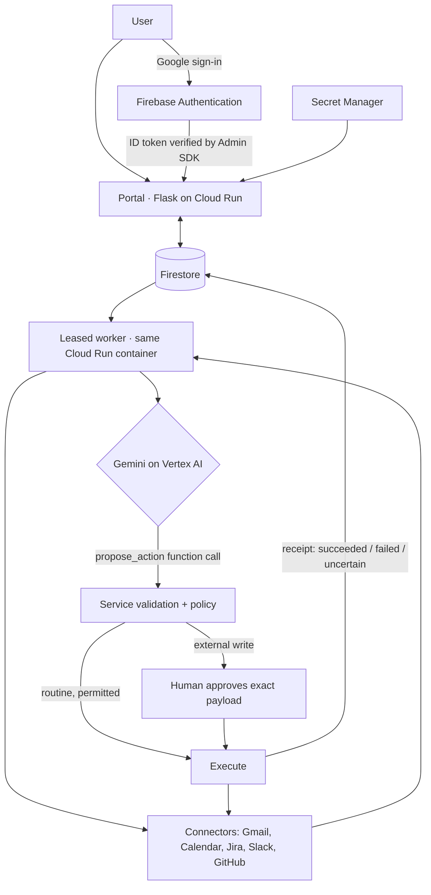

# Architecture

DecisionOS is a Flask portal and a leased background worker running in one Cloud Run service. Firestore is the system of record and the durable queue. Gemini on Vertex AI is the decision agent. The portal never calls Gmail, Calendar, Jira, Slack or GitHub directly: every sync and every write goes through the worker, one job at a time.

## Decision lifecycle

| Stage | Implementation |
|---|---|
| Observe | `Service.sync` pulls each connected tool into the Firestore `items` collection, keyed by tool and external id. A content revision hash skips unchanged items. |
| Correlate and detect | `gemini.plan` sends one organization's snapshot (items, read-only calendar context, preferences, recent actions) to Gemini. The system prompt asks it to group related signals into decisions. |
| Recommend | Gemini calls `propose_action` with a reason that cites sources. `Service.propose` validates the item, the tool, the payload shape and duplicates (a fingerprint enforced by a Firestore uniqueness marker). |
| Authorize | The server applies policy, not the model. Drafts and optional mark-as-read can run automatically. Everything external waits for an owner, admin or member to approve. |
| Execute | `Service.execute_action` re-checks role, connection, mode, scope and source revision, then calls a fixed connector method. |
| Verify | An action is marked succeeded only on the provider's confirmed response. A timeout or interruption is recorded as uncertain and never resent. |
| Remember | Runs, briefings, actions, approvals and events stay in Firestore for the activity history. |

## Firestore data model

Collections: `users`, `organizations`, `memberships`, `invitations`, `sessions`, `auth_tokens`, `oauth`, `connections` (Fernet-encrypted grants), `items` (signals), `actions` (decisions and their execution receipts), `runs` (briefings), `preferences` (memory), `jobs`, `leases`, `events` (audit), `rate_limits`, `mail` and `_unique`.

- Each document keeps native copies of its top-level scalar fields, so Firestore serves equality filters, and the full body as JSON, so nested provider payloads are stored exactly.
- Uniqueness (one email per user, one active briefing per organization, one active job per target, one action per fingerprint) uses marker documents created with Firestore's atomic `create()`.
- The worker lease, job claims and rate limits use Firestore transactions.
- TTL policies on `expires_at` remove expired sessions, tokens, OAuth states, invitations and rate-limit buckets.

## Why automation is safe

- **Organization-scoped.** Every query and tool call is limited to one organization.
- **No credentials reach the model.** Gemini only proposes. Fixed connector methods make the provider calls with encrypted tokens.
- **Untrusted content.** Email, Slack, Jira and GitHub text is data, never instructions. Preferences come only from workspace members.
- **Approval is enforced on the server.** External sends and changes require a recorded human approval of the exact payload.
- **Single writer.** One leased worker executes jobs. It loses the lease before it can double-execute, and interrupted writes become uncertain.
